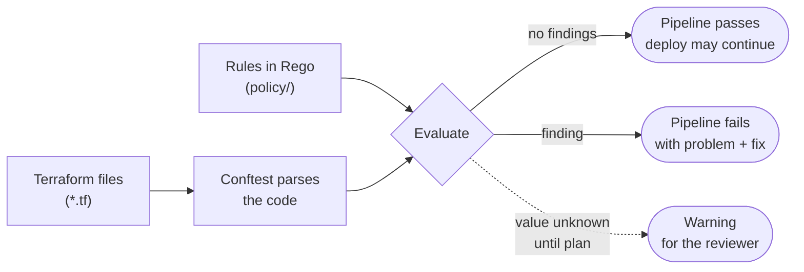

# Azure Terraform security guardrails

[](../../actions/workflows/policy.yml)

Security rules, written as code, that check Terraform files for Azure **before
anything is deployed**. If a storage account is public, a management port is
open to the internet or a password is typed into the code, the pipeline fails
and tells the engineer what is wrong and how to fix it.

Each rule starts from an attacker's point of view: *what could someone do with
this mistake?* That reasoning is written next to every rule.

## How it works



The rules are written in [Rego](https://www.openpolicyagent.org/docs/policy-language),
the policy language of Open Policy Agent, and run with
[Conftest](https://www.conftest.dev/). Nothing is deployed and no Azure
account is needed: the check reads the code only, so it takes seconds and can
run on every pull request.

## The rules

| ID | Severity | What it catches | What an attacker could do |
| --- | --- | --- | --- |
| AZ-001 | High | Storage account allows public blob access | Download the data without logging in |
| AZ-002 | Medium | Storage account accepts TLS 1.0 / 1.1 | Read or change data in transit |
| AZ-003 | Critical | SSH or RDP open to the whole internet | Guess passwords or exploit the service directly |
| AZ-004 | Medium | Key Vault without purge protection | Permanently destroy all keys and secrets |
| AZ-005 | High | Key Vault reachable from any network | Use a stolen credential from anywhere |
| AZ-006 | High | Web or function app also answers over HTTP | Intercept sessions and passwords |
| AZ-007 | High | Linux VM allows password logins | Brute-force or reuse a leaked password |
| AZ-008 | High | SQL server with a public endpoint | Attack the database directly |
| AZ-009 | Critical | Password, key or token written in the code | Read it from the repository or its history |
| AZ-000 | Info (warning) | Security setting filled from a variable | Nothing by itself - the reviewer must check the real value |

Details per rule, including the matching MITRE ATT&CK technique, are in
[docs/rules.md](docs/rules.md).

## What the output looks like

Running the rules on [examples/insecure/main.tf](examples/insecure/main.tf):

```
FAIL - AZ-001 [HIGH] azurerm_storage_account.data: blobs in this storage account can be made publicly readable. Fix: set allow_nested_items_to_be_public = false.
FAIL - AZ-003 [CRITICAL] azurerm_network_security_group.vm: rule "allow-ssh" opens SSH (port 22) to the whole internet. Fix: limit the source to a known IP range, or use Azure Bastion or a VPN.
FAIL - AZ-009 [CRITICAL] azurerm_linux_virtual_machine.jump: the value of "admin_password" is written directly in the code. Fix: pass it in through a sensitive variable or read it from Key Vault.
...
13 tests, 1 passed, 0 warnings, 12 failures, 0 exceptions
```

Every finding names the rule, the severity, the exact resource, the problem and
the fix. [examples/secure/main.tf](examples/secure/main.tf) is the same
environment with everything fixed, and produces no findings.

## Repository layout

```
.
├── policy/
│   ├── lib.rego             # Shared helpers
│   ├── storage.rego         # AZ-001, AZ-002
│   ├── network.rego         # AZ-003
│   ├── keyvault.rego        # AZ-004, AZ-005
│   ├── compute.rego         # AZ-006, AZ-007
│   ├── database.rego        # AZ-008
│   ├── secrets.rego         # AZ-009
│   ├── unverifiable.rego    # AZ-000
│   └── rules_test.rego      # 35 unit tests
├── examples/
│   ├── insecure/            # Deliberately vulnerable Terraform (never deploy)
│   └── secure/              # The same environment, fixed
├── scripts/check-examples.sh
├── docs/
│   ├── rules.md
│   └── design-decisions.md
└── .github/workflows/policy.yml
```

## Run it yourself

Install [Conftest](https://www.conftest.dev/install/), then:

```bash
# Scan Terraform files
conftest test --parser hcl2 --policy policy examples/insecure/main.tf

# Run the unit tests for the rules
conftest verify --policy policy

# End-to-end check on both example environments (needs jq)
./scripts/check-examples.sh
```

## Use it in another repository

Add this step to a GitHub Actions workflow, after installing Conftest:

```yaml
- name: Security guardrails
  run: |
    git clone --depth 1 https://github.com/<owner>/azure-terraform-security-guardrails guardrails
    conftest test --parser hcl2 --policy guardrails/policy $(git ls-files '*.tf')
```

## How the rules are tested

A security rule that silently stops working is worse than no rule, so the rules
are tested like any other code:

| Layer | What it proves |
| --- | --- |
| Unit tests (`rules_test.rego`) | Each rule fires on an insecure input and stays quiet on a secure one, including edge cases such as port ranges and missing settings |
| Insecure example | All nine rules fire on realistic Terraform - no more, no fewer |
| Secure example | A correctly built environment produces zero findings (no false positives) |
| Real project scan | The pipeline scans my `azure-secure-webapp-terraform` repository with these rules on every run |

## Limits

These rules read the code, not the deployed environment:

- Values that come from variables are unknown until `terraform plan`. Those are
  reported as an AZ-000 warning instead of being guessed.
- Settings changed by hand in the Azure portal are not seen.
- The rule set covers common, high-impact mistakes. It is not a replacement
  for a full scanner or for Microsoft Defender for Cloud.

More background is in [docs/design-decisions.md](docs/design-decisions.md).

## Author

Built by [JerProjects8576](https://github.com/JerProjects8576), a final-year
Computer Engineering student looking for a graduation internship in Cloud
Engineering or DevOps.
